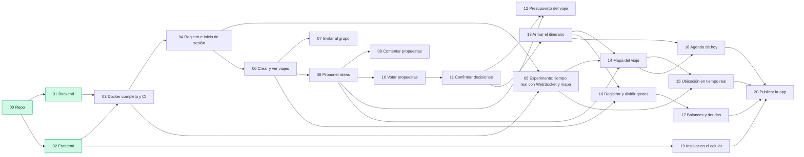

# Features del proyecto

Cada feature tiene **una rama** y **un documento** con su especificación. El documento se llama igual que la rama, sin el tipo.

## Cómo tomar una feature

1. Elegí una feature cuyas dependencias estén ✅ (ver el mapa de abajo y [CONTEXT.md](../../CONTEXT.md#estado-del-proyecto)).
2. Asignate el issue en el [tablero del proyecto](https://github.com/users/FacuAmaya/projects/1) y movelo a *En curso*.
3. Traé la rama y actualizala con lo último de `main` (las ramas se crearon por adelantado y pueden estar atrasadas):
   ```bash
   git fetch origin
   git switch funcionalidad/NN-descripcion
   git merge origin/main
   ```
4. Leé el documento, respondé las *Preguntas abiertas* con el equipo y anotá las *Decisiones*.
5. Trabajá en la rama (commits chicos) y abrí el PR con `Closes #<issue>`.

## Mapa de dependencias

Una flecha `A --> B` significa *B necesita que A esté terminada*.



## Lista

| # | Feature | Rama | Depende de | Historias | Issue |
|---|---|---|---|---|---|
| 00 | [Preparar repositorio](00-preparar-repositorio.md) | `base/00-preparar-repositorio` | — | — | — |
| 01 | [Backend FastAPI](01-backend-fastapi.md) | `base/01-backend-fastapi` | 00 | — | — |
| 02 | [Frontend Next.js](02-frontend-nextjs.md) | `base/02-frontend-nextjs` | 00 | — | — |
| 03 | [Docker completo y CI](03-docker-y-ci.md) | `base/03-docker-y-ci` | 01, 02 | — | [#5](https://github.com/FacuAmaya/Organiviaje/issues/5) |
| 04 | [Registro e inicio de sesión](04-registro-e-inicio-de-sesion.md) | `funcionalidad/04-registro-e-inicio-de-sesion` | 03 | — | [#6](https://github.com/FacuAmaya/Organiviaje/issues/6) |
| 05 | [Experimento: tiempo real con WebSocket y mapa](05-tiempo-real.md) | `experimento/05-tiempo-real` | 03, 04 | — | [#7](https://github.com/FacuAmaya/Organiviaje/issues/7) |
| 06 | [Crear y ver viajes](06-crear-y-ver-viajes.md) | `funcionalidad/06-crear-y-ver-viajes` | 04 | US001, US005, US010 | [#8](https://github.com/FacuAmaya/Organiviaje/issues/8) |
| 07 | [Invitar al grupo](07-invitar-al-grupo.md) | `funcionalidad/07-invitar-al-grupo` | 06 | US003, US004, US006 | [#9](https://github.com/FacuAmaya/Organiviaje/issues/9) |
| 08 | [Proponer ideas](08-proponer-ideas.md) | `funcionalidad/08-proponer-ideas` | 06 | US025, US026, US027, US028, US030, US035, US039, US013, US020, US063, US064, US071, US072 | [#10](https://github.com/FacuAmaya/Organiviaje/issues/10) |
| 09 | [Comentar propuestas](09-comentar-propuestas.md) | `funcionalidad/09-comentar-propuestas` | 08 | US037, US151 | [#11](https://github.com/FacuAmaya/Organiviaje/issues/11) |
| 10 | [Votar propuestas](10-votar-propuestas.md) | `funcionalidad/10-votar-propuestas` | 08 | US041, US044, US047, US015, US053, US054 | [#12](https://github.com/FacuAmaya/Organiviaje/issues/12) |
| 11 | [Confirmar decisiones](11-confirmar-decisiones.md) | `funcionalidad/11-confirmar-decisiones` | 10 | US056, US016, US021, US068, US057, US061 | [#13](https://github.com/FacuAmaya/Organiviaje/issues/13) |
| 12 | [Presupuesto del viaje](12-presupuesto-del-viaje.md) | `funcionalidad/12-presupuesto-del-viaje` | 08, 11 | US141, US022, US142, US147 | [#14](https://github.com/FacuAmaya/Organiviaje/issues/14) |
| 13 | [Armar el itinerario](13-armar-itinerario.md) | `funcionalidad/13-armar-itinerario` | 11 | US075, US077, US078, US079, US090 | [#15](https://github.com/FacuAmaya/Organiviaje/issues/15) |
| 14 | [Mapa del viaje](14-mapa-del-viaje.md) | `funcionalidad/14-mapa-del-viaje` | 05, 08, 13 | US029, US091, US092, US093, US097, US043, US066, US101, US099, US109 | [#16](https://github.com/FacuAmaya/Organiviaje/issues/16) |
| 15 | [Ubicación en tiempo real](15-ubicacion-en-tiempo-real.md) | `funcionalidad/15-ubicacion-en-tiempo-real` | 05, 14 | US183, US184 | [#17](https://github.com/FacuAmaya/Organiviaje/issues/17) |
| 16 | [Registrar y dividir gastos](16-registrar-y-dividir-gastos.md) | `funcionalidad/16-registrar-y-dividir-gastos` | 06, 13 | US111, US112, US113, US114, US115, US118, US120 | [#18](https://github.com/FacuAmaya/Organiviaje/issues/18) |
| 17 | [Balances y deudas](17-balances-y-deudas.md) | `funcionalidad/17-balances-y-deudas` | 16 | US131, US132, US133, US134, US176 | [#19](https://github.com/FacuAmaya/Organiviaje/issues/19) |
| 18 | [Agenda de hoy](18-agenda-de-hoy.md) | `funcionalidad/18-agenda-de-hoy` | 13, 14 | US167, US168 | [#20](https://github.com/FacuAmaya/Organiviaje/issues/20) |
| 19 | [Instalar en el celular (PWA)](19-instalar-en-celular.md) | `funcionalidad/19-instalar-en-celular` | 02 | — | [#21](https://github.com/FacuAmaya/Organiviaje/issues/21) |
| 20 | [Publicar la app (deploy)](20-publicar-la-app.md) | `base/20-publicar-la-app` | todas | — | [#22](https://github.com/FacuAmaya/Organiviaje/issues/22) |

R2 y R3: ver el [plan de desarrollo](../plan/plan-desarrollo.md#6-hoja-de-ruta-de-ramas); se especifican al llegar.
